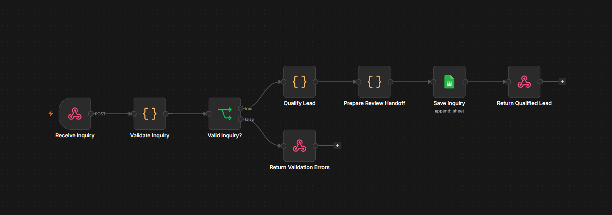
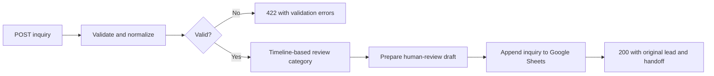

# Lead Intake & Qualification

An n8n prototype I adapted and manually tested for inquiries about my email and form-to-Google-Sheets automation services. It validates a request, assigns a timeline-based review category, prepares draft reply text, and logs valid inquiries in Google Sheets.

**Stack:** n8n, JavaScript, Google Sheets, HTTP webhooks.

## My contribution

I applied guided changes to an AI-assisted starter in my n8n instance, chose the two supported services, configured the Sheets connection and eleven column mappings, and ran sample requests to inspect the results. During guided troubleshooting, I removed a leftover validation statement and changed the Sheets operation from Append or Update Row to Append Row. I then verified the three review categories, successful storage, and rejection without another sheet row.

AI assistance supplied the original starter, code revisions, explanations, and offline review. This repository contains the sanitized version of my updated export. It does not claim independent authorship of the starter or measured business results.

## Walkthrough and evidence

Visit [Build with Hanz](https://buildwithhanz.vercel.app), open Projects, and explore Lead Intake & Qualification. Its 30-second video is an illustrative sample-data walkthrough with actual workflow and test screenshots. The interactive browser demo uses the same JavaScript rules and shows a local tracker preview; it does not call your Google account.



## Workflow



## Setup

1. Import `workflows/lead-intake.json` into n8n. The shared workflow is inactive and contains no credential bindings.
2. Create a Google spreadsheet with a tab named `Leads`. Paste or import the header row from `examples/leads-headers.csv`.
3. In **Save Inquiry**, connect your Google Sheets credential, replace `REPLACE_SPREADSHEET_ID` with your document, select `Leads`, and check all eleven mappings. Keep the operation **Append Row**.
4. Keep **Return Qualified Lead** configured to read `$('Prepare Review Handoff').item.json`. That preserves the full response after the sheet node.
5. Open **Receive Inquiry**, copy its **Test URL**, and click **Execute workflow** on the canvas to wait for a request through the full workflow.
6. Send a sample using the PowerShell example below. Check the returned JSON and the new sheet row. Re-arm **Execute workflow** before each test request.

```powershell
$samples = Get-Content examples/leads.json -Raw | ConvertFrom-Json
$body = $samples[0].input | ConvertTo-Json
$webhookUrl = 'PASTE_THE_TEST_URL_FROM_YOUR_RECEIVE_INQUIRY_NODE'
Invoke-RestMethod -Method Post -Uri $webhookUrl -ContentType 'application/json' -Body $body | ConvertTo-Json -Depth 10
```

The Google Sheets connection is required to complete a valid request. No AI credential is needed. Test email addresses use `example.com`; no messages are sent.

## Input contract

| Field | Validation |
| --- | --- |
| `name` | Single-line string, 2–100 characters |
| `email` | Single-line email address, maximum 254 characters; lowercased |
| `company` | Single-line string, 2–100 characters |
| `service` | `email-workflows` or `form-to-sheets` |
| `budgetUsd` | Optional; omit or use `null` if undecided. A provided value must be an integer from 0 to 1,000,000. Zero is preserved; strings are rejected. |
| `timeline` | `this-month`, `next-quarter`, or `exploring` |
| `message` | String, 20–4,000 characters |
| `consent` | Boolean `true` |

Unknown fields are discarded. The webhook body must be a JSON object. This version's maximum budget value is an input-validation limit, not a pricing threshold.

## Review policy and storage

| Requested timeline | Category | Next step |
| --- | --- | --- |
| This month | Priority | Review scope and availability before arranging a discovery call |
| Next quarter | Standard | Review the process, tools, and desired outcome |
| Exploring | Discovery | Ask which repetitive task to improve first |

Budget is information for discussion and does not affect the category. There is no numerical score or automatic project acceptance.

Valid requests append a row with Received At, Name, Email, Company, Service, Timeline, Budget USD, Message, Priority, Next Step, and Review Status. Null budgets appear as `Undecided`, review status starts as `New`, and the logging timestamp uses `Asia/Taipei`. The returned draft is plain text for human review, not a Gmail draft.

## Build and test

With Node.js 22 or later, run `npm run build` and `npm test`. No npm dependencies need to be installed. The builder preserves the reviewed eight-node export and embeds the source functions from `src/qualification.mjs`.

The tests cover source behavior, exported Code-node parity, optional and zero budgets, validation, timeline categories, draft preparation, mappings, branch routing, and sanitization. These tests do not contact Google. [VERIFICATION.md](docs/VERIFICATION.md) separates the current manual integration evidence, the 17-case offline export review, and historical starter results.

When working in the local portfolio workspace, `node scripts/build-workflow.mjs --portfolio` also refreshes its shared functions, examples, and workflow download.

## Limitations and next steps

This is a manually tested portfolio prototype. A user-facing form, duplicate protection, notifications, and recovery from partial failures are future work. Repeated successful requests currently append repeated rows. The n8n instance must remain running. Before exposing the webhook publicly, configure authentication or appropriate abuse controls and agree how inquiry data should be retained.

If Sheets fails, the success response is not reached. There is no automatic email sending, conversion prediction, or measured time-saved claim.
