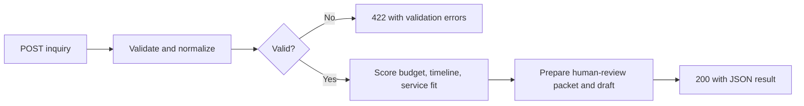

# Lead Intake & Qualification

A small n8n portfolio prototype that turns a JSON inquiry into a validated, prioritized review packet and an unsent follow-up draft.

**Stack:** n8n, JavaScript, HTTP webhooks, JSON.

**Scope:** Validation, normalization, transparent rule-based scoring, and a human-review handoff. This version does not use AI, store leads in a CRM, deduplicate submissions, or send email. Its scoring thresholds are illustrative business rules, not a measured prediction of conversion.

## Business problem

Inquiries arrive with different budgets, timelines, and service needs. A consistent intake process can identify incomplete submissions and give a reviewer a useful starting point without making commitments to a prospect.

## How it works



## Try it in n8n

1. Import `workflows/lead-intake.json` into your n8n instance. It is inactive and has no credential bindings.
2. Open **Receive Inquiry**, select its **Test URL**, and choose **Listen for test event**.
3. Copy a sample `input` object from `examples/leads.json` and send it as JSON using PowerShell below. Use the URL displayed by your own n8n node.
4. Inspect the execution. Valid inquiries return a score, priority, explanation, next step, and plain-text draft. Invalid inquiries return HTTP 422 with field errors.
5. Re-enable the test listener before each test call if your instance requires it. Keep this unauthenticated demo local. A public intake needs authentication or appropriate abuse controls and a data-retention policy.

```powershell
$samples = Get-Content examples/leads.json -Raw | ConvertFrom-Json
$body = $samples[0].input | ConvertTo-Json
Invoke-RestMethod -Method Post -Uri 'http://localhost:5678/webhook-test/hanz-lead-intake' -ContentType 'application/json' -Body $body
```

No Google or AI credentials are needed for this version. Nothing is sent to the sample email addresses.

## Input contract

| Field | Validation |
| --- | --- |
| `name` | Single-line string, 2–100 characters |
| `email` | Single-line email address, maximum 254 characters; normalized to lowercase |
| `company` | Single-line string, 2–100 characters |
| `service` | `automation`, `integration`, or `reporting` |
| `budgetUsd` | Integer from 0 to 1,000,000; strings are rejected |
| `timeline` | `this-month`, `next-quarter`, or `exploring` |
| `message` | String, 20–4,000 characters |
| `consent` | Boolean `true` |

Unknown properties are discarded. The workflow expects a JSON object in the webhook body. Drafts are plain text and must be reviewed before use.

## Qualification rules

Every valid inquiry starts with 20 points. Budget adds 35 points at $5,000 or more, 20 points at $1,000–$4,999, and zero below that. Timeline adds 30 points for this month, 15 for next quarter, and zero for exploring. Automation adds 15 service-fit points; integration and reporting add 10.

- **Priority:** 75 points or more, review for a discovery call.
- **Standard:** 40–74 points, review scope and ask for details.
- **Discovery:** Under 40 points, review goals before recommending a service.

These rules can be changed to match an actual business. A score does not determine whether a person deserves a response.

## Build and test

With Node.js 22 or later, run `npm run build` and `npm test`. No dependencies need to be installed.

The build embeds the functions from `src/qualification.mjs` into n8n Code nodes. Nine regression tests cover the three sample priorities, normalization, malformed submissions, invalid field types, consent, injection-like contact fields, scoring boundaries, and execution of the exported Code-node bodies.

Local logic checks pass. Runtime import and webhook checks in n8n are recorded separately in `docs/VERIFICATION.md`; local JavaScript checks alone do not establish n8n compatibility.

## Development notes and next steps

This project was developed with AI assistance. Its current purpose is a reproducible portfolio exercise. Before presenting it in an interview, run it in your own n8n instance, change a scoring rule, and explain the validation and handoff behavior yourself.

Planned extensions include persistent storage, idempotent submission IDs, authenticated intake, notifications, and failure recovery. None are claimed as implemented in this release.
