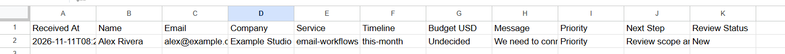

# Verification record

## Current eight-node workflow

Hanz applied the guided changes and ran sample requests in his own n8n instance. The conversation includes the resulting JSON, a saved sheet row, and confirmation of the other timeline and rejection checks.

| Manual check | Observed or reported result |
| --- | --- |
| Email-workflows inquiry | Supported input passed validation and completed the handoff |
| Form-to-Sheets inquiry | Supported input passed validation and completed the handoff |
| Omitted budget | Normalized to null; sheet displayed Undecided |
| This month | Priority |
| Next quarter | Standard |
| Exploring | Discovery |
| Unsupported service | Validation error |
| Valid inquiry with Sheets enabled | Row appended with review status New |
| Missing consent with Sheets enabled | Invalid response and unchanged sheet row count |

The initially selected Append or Update Row operation failed because no matching column was specified. Switching to Append Row and checking the mappings resolved that run. A leftover unconditional validation-error statement was also corrected during guided code review.

## Offline code and configuration review

An AI-assisted review evaluated 17 cases against the actual supplied export. All passed. `export-review-results.json` records the cases and scope. This review used synthetic data and Code-node stubs, without live n8n executions or requests to Google Sheets. The regression suite in `tests/qualification.test.mjs` additionally checks the maintained source and generated export.

## Historical starter results

`runtime-results.json` records five real HTTP scenarios from the original seven-node scoring starter in an isolated n8n 2.47.3 instance. They predate the service changes, optional budgets, timeline-only review, and Sheets integration. They are retained as historical evidence and do not establish current live-service coverage.

## Boundaries

The project has not been evaluated against real client inquiries or measured for conversion or time saved. Duplicate handling and recovery from partial failures have not been demonstrated. Video interface scenes are labeled illustrative; the workflow and sheet images are supplied manual-test evidence.
